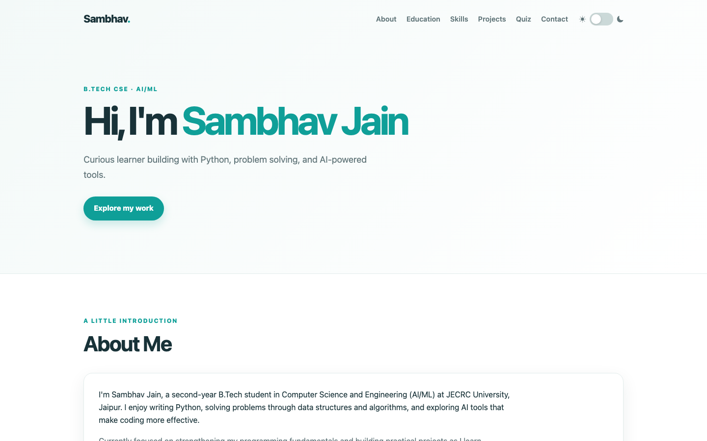
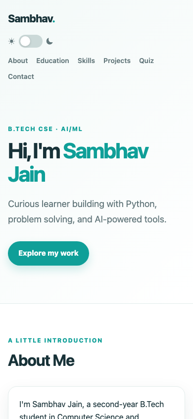

# Sambhav Jain - Personal Portfolio Website

🌐 **Live Website:** [View Portfolio](https://sambhav0343.github.io/sambhav-portfolio/)

📂 **GitHub Repository:** [sambhav-portfolio](https://github.com/sambhav0343/sambhav-portfolio)

---

## 📌 Overview

This repository contains my personal portfolio website, created as part of **Module 3 – AI for Web Development** for the AI & Prompt Engineering Lab.

The website introduces me, my education, technical skills, projects, and contact information. It also includes an interactive Python and AI quiz to demonstrate basic JavaScript functionality.

The portfolio was developed using HTML, CSS, and JavaScript, with assistance from ChatGPT. No external frameworks, libraries, or build tools are required.

The project was built step by step through multiple assignments, starting with the basic website and ending with a deployed, responsive portfolio.

## ✨ Features

- **Responsive Navigation:** Header with navigation links to all major sections.
- **About Me:** A short introduction and personal profile.
- **Education Timeline:** Displays my academic background in a timeline format.
- **Skills Section:** Technical skills displayed using progress bars.
- **Projects Section:** Project cards highlighting my work.
- **Python & AI Quiz:** An interactive five-question multiple-choice quiz.
- **Light/Dark Mode:** Sliding toggle to switch between light and dark themes.
- **Theme Persistence:** Saves the selected theme using `localStorage`.
- **Quiz Results:** Green and red answer marking, correct answers, score bar, and a Try Again option.
- **Contact Form:** Includes input labels, trimmed input values, basic email validation, and an encoded `mailto` link.
- **Mobile-Friendly Design:** Responsive layout for screens below 700px.
- **GitHub Pages Deployment:** Publicly accessible live website.

## 📸 Screenshots

| Desktop | Phone (390 px) |
| --- | --- |
|  |  |

## 🛠️ Tech Stack
The project uses basic web development technologies without any frameworks.

| Technology   | Purpose                                             |
| ------------ | --------------------------------------------------- |
| HTML5        | Website structure and content                       |
| CSS3         | Styling, layouts, animations, and responsive design |
| JavaScript   | Theme switching, quiz logic, and form validation    |
| localStorage | Saving the selected theme                           |
| Git          | Version control                                     |
| GitHub       | Repository hosting and collaboration                |
| GitHub Pages | Website deployment                                  |
| ChatGPT      | AI assistance during development and debugging      |

**No frameworks or build tools are used.**

## 📁 Project Structure
The repository has a simple structure:

```
sambhav-portfolio/
│
├── index.html      # Main HTML file containing all website sections
├── style.css       # CSS styles, themes, and responsive design
├── script.js       # JavaScript functionality and interactions
├── screenshots/    # Desktop and phone screenshots used in this README
├── LICENSE         # MIT License
│
└── README.md       # Project documentation
```

There are no additional dependencies or installation requirements.

## 🚀 Getting Started
Follow these steps to run the project on your computer.

### Prerequisites
You only need:

- A computer with a modern web browser.
- Git (optional, if you want to clone the repository).
- A code editor such as Visual Studio Code.

### 1. Clone the Repository
Open your terminal and run:

```
git clone https://github.com/sambhav0343/sambhav-portfolio.git
```

### 2. Open the Project Folder
```
cd sambhav-portfolio
```

### 3. Run the Website
Since this project uses plain HTML, CSS, and JavaScript, there is no installation or build process.

You can simply open `index.html` in your browser.

Alternatively, if you use Visual Studio Code, install the Live Server extension and select:

**Open with Live Server**

The website should now be running locally.

## 🌐 Deployment on GitHub Pages
The portfolio is hosted using GitHub Pages.

Live URL:

[https://sambhav0343.github.io/sambhav-portfolio/](https://sambhav0343.github.io/sambhav-portfolio/)

### Deployment Steps
1. Push the project files to your GitHub repository.
2. Open the repository on GitHub.
3. Navigate to **Settings**.
4. Select **Pages** from the sidebar.
5. Under **Build and deployment**, select **Deploy from a branch**.
6. Choose the `main` branch.
7. Select the `/ (root)` folder.
8. Click **Save**.
9. Wait for GitHub Pages to publish the website.

After deployment, the website becomes accessible through the GitHub Pages URL.

Whenever new changes are pushed to the selected branch, GitHub Pages automatically updates the deployed website.

## ⚙️ How It Works
### 1. Light/Dark Mode
The website includes a sliding toggle in the header that allows visitors to switch between light and dark themes.

- Light mode uses the default color scheme.
- Dark mode changes the CSS variables to a dark navy background while keeping the teal accent color.
- JavaScript handles the theme switching.
- The selected theme is saved in browser `localStorage`.
- When the visitor reloads the page, the previously selected theme is restored.

This allows visitors to keep their preferred appearance across page reloads.

### 2. Python & AI Quiz
The quiz contains five multiple-choice questions about Python and Artificial Intelligence.

**Quiz functionality:**

1. All five questions are displayed together in one form.
2. Each question provides multiple-choice radio button options.
3. The visitor selects answers and submits the quiz.
4. JavaScript checks the selected answers against the correct answers.
5. Correct answers are marked in green.
6. Incorrect answers are marked in red.
7. The correct answers are displayed after submission.
8. A score bar shows the final result.
9. A Try Again button allows visitors to attempt the quiz again.

The quiz uses JavaScript for answer checking, result calculation, and updating the page without reloading it.

### 3. Contact Form
The contact section provides a form through which visitors can prepare an email.

The form includes:

- Name field.
- Email field.
- Message field.
- Labels for all inputs.
- Input validation before submission.

**Validation process:**

1. JavaScript reads the entered values.
2. Leading and trailing spaces are removed using `trim()`.
3. Empty fields are rejected.
4. The email address is checked using basic email validation.
5. If the inputs are valid, the form prepares an encoded `mailto` link.
6. The visitor's default email application opens with the recipient, subject, and message filled in.

The contact form does not use a backend server or database. It relies on the visitor's email application to send the message.

## 🔀 Git Workflow
Git and GitHub were used to manage the development process and track changes.

The project was developed through multiple assignments.

### Assignment 9 – Basic Portfolio
- Created the initial website using HTML and CSS.
- Added the basic website structure and sections.
- Used ChatGPT to assist with the development process.

### Assignment 10 – JavaScript Features
- Added the light/dark mode toggle.
- Implemented theme persistence using `localStorage`.
- Created the five-question Python and AI quiz.
- Added quiz scoring, answer marking, and retry functionality.
- Used ChatGPT for JavaScript assistance.

### Assignment 12 – Contact Form and Pull Request
- Created a separate feature branch for the contact form.
- Added form validation and email functionality.
- Created Pull Request #1 on GitHub.
- Used ChatGPT to review the pull request.
- The review identified six issues, including:
  - Cross-Site Scripting (XSS) risks.
  - Incorrect or missing URL encoding in the `mailto` link.
  - Additional validation, accessibility, and best-practice issues.
- Applied the suggested fixes.
- Reviewed the updated code.
- Merged the pull request into the main branch.

### Assignment 13 – Deployment
- Prepared the final project for deployment.
- Configured GitHub Pages.
- Published the website.
- Verified the live website.

### Example Git Commands
The following commands demonstrate the basic workflow used for managing changes:

```
# Check the current Git status
git status

# Create a feature branch
git checkout -b feature/contact-form

# Add modified files
git add .

# Commit changes
git commit -m "Add contact form with validation"

# Push the feature branch
git push origin feature/contact-form
```

After reviewing and merging the pull request, the final changes become part of the main branch.

## 🤖 Use of AI
ChatGPT was used as an AI assistant throughout the development of this portfolio.

The purpose was to understand how AI tools can support web development while still requiring human review and testing.

### How ChatGPT Was Used
- Generated and improved HTML structure.
- Assisted with CSS styling and responsive layouts.
- Helped implement the light/dark mode feature.
- Assisted with JavaScript quiz functionality.
- Helped implement contact form validation.
- Reviewed Pull Request #1.
- Identified security, accessibility, and code-quality issues.
- Suggested fixes for identified problems.
- Assisted in preparing project documentation.

### What Was Checked by Hand
AI-generated code was not accepted without review.

The following things were checked manually:

- Website layout and navigation.
- Light/dark mode switching.
- Theme persistence after reloading the page.
- Quiz answer checking and score calculation.
- Correct and incorrect answer highlighting.
- Try Again functionality.
- Contact form validation.
- Handling of spaces in user inputs.
- Email address validation.
- URL encoding in the generated `mailto` link.
- Safe handling of user-provided input to avoid XSS.
- Responsive behavior on smaller screens.
- Git branch, commit, and pull request workflow.
- GitHub Pages deployment and live website accessibility.

This project demonstrates that AI can speed up development, but human review, testing, and understanding of the code remain important.

## ⚠️ Known Limitations
Some limitations of the current version include:

- The contact form does not have a backend.
- Messages are prepared using a `mailto` link, so sending depends on the visitor having a working email application.
- There is no database to store contact form submissions.
- Email validation is basic and does not guarantee that an email address actually exists.
- The quiz currently contains only five predefined questions.
- Quiz scores are not stored permanently.
- The website is a static website and does not include user accounts or authentication.
- Skill progress bars are visual representations and do not necessarily indicate objectively measured skill levels.
- The browser's email check accepts addresses without a dot in the domain (for example `ravi@gmail`).
- `script.js` loads with `defer`, so a visitor who saved dark mode may briefly see the light theme while the page loads.
- After the quiz is submitted, the "QUESTION n" label sits just outside the coloured result box.

## 🔮 Future Scope
The following improvements could be added in future versions:

- Add a backend-powered contact form.
- Store contact messages securely.
- Add more questions and categories to the quiz.
- Add a timer and difficulty levels to the quiz.
- Store quiz scores using browser storage.
- Add more projects with live demos and GitHub links.
- Improve accessibility and keyboard navigation.
- Add more animations and interactive elements.
- Improve SEO and social media preview metadata.
- Add downloadable resume functionality.
- Add a project filtering feature.
- Improve form validation and user feedback.

## 👨‍💻 Author
**Sambhav Jain**

- **Course:** B.Tech Computer Science and Engineering (AI/ML)
- **Year:** 2nd Year
- **University:** JECRC University, Jaipur
- **Email:** jainsambhav0343@gmail.com
- **GitHub:** [@sambhav0343](https://github.com/sambhav0343)

### Academic Information
| Detail        | Information                          |
| ------------- | ------------------------------------ |
| Subject       | AI & Prompt Engineering Lab          |
| Module        | Module 3 – AI for Web Development    |
| Assignment 9  | HTML and CSS Portfolio               |
| Assignment 10 | Dark Mode and Python & AI Quiz       |
| Assignment 12 | Contact Form and Pull Request Review |
| Assignment 13 | GitHub Pages Deployment              |

## 📄 License
This project is licensed under the **MIT License**.

You are free to use, copy, modify, distribute, and share this project, subject to the conditions of the MIT License.

See the [LICENSE](LICENSE) file for the full text.

⭐ **Thank you for visiting my portfolio repository!**

This project represents my learning journey in HTML, CSS, JavaScript, Git, GitHub, and AI-assisted web development.

**Live Portfolio:** [Visit Website](https://sambhav0343.github.io/sambhav-portfolio/)

**GitHub Repository:** [View Source Code](https://github.com/sambhav0343/sambhav-portfolio)
